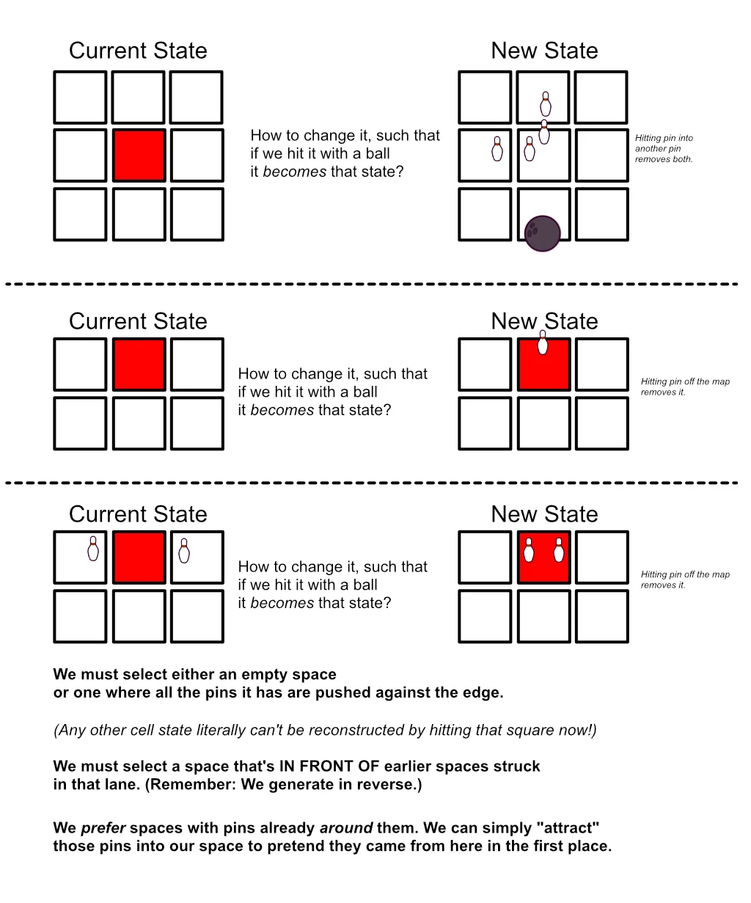

# Pinstrike! (Devlog)

Welcome to the devlog (or "developer's diary") for my game **Pinstrike!** It's an educational (digital) puzzle game mainly about directions, spatial awareness, and counting. And, of course, _bowling_.

In this article I'll briefly discuss the process of making the game, any interesting problems faced and lessons learned.

## What's the idea?

I was brainstorming possible puzzle games about directions as well as "pre-counter" puzzle games. That is, a game that intuitively teaches kids the idea of counting and numbers, without already requiring number knowledge or fully teaching that topic.

At some point during that evening I talked with someone about those Kinect games we used to have, where you had to play darts, or bowling, or tennis by actually moving your body in front of its camera. 

Well, that's how the idea of a Bowling puzzle game came to be.

* The puzzle shows a few (vertical) "lanes". (Each lane is broken into a few cells too, so you essentially just have a small 2D grid of square cells.)
* Each move, you tap **one lane** to throw a bowling ball onto it.
  * It hits the first space that has pins. 
  * Those pins will scatter away. (Example: a pin on the left will scatter to the lane on the left.)
* You win by **clearing the map**: all pins have scattered off the map / out of bounds.

I liked this idea because it's unique/thematic/realistic, sure, but also because it's **simple to use**. Players---young kids---only have to _tap a lane_. No precise taps, no complex movements, no array of buttons to press, just simple interaction.

This core idea would be the Easiest difficulty, and it's only about estimating directions. 

Harder difficulties would add the "counting" part by having **bowling balls with numbers** (their "size" or "weight", if you will). 

* If your number is _lower_ than the number of pins (on the square you hit), then nothing happens. An invalid move, because the ball wasn't strong enough to scatter the pins.
* If your number is _exactly_ the number of pins (on the square you hit), then all pins immediately disappear without scattering.
* (And then, of course, if your number is _higher_ then the usual rules simply hold.)

I envisioned a puzzle about tactically scattering pins so they're in the right position. About some pins "traveling" over the board, ending up in another place, to get the right numbers or win with one final move.

## Did that work?

I started making that idea.

Rather quickly, I realized another situation I had to solve: what if a pin had to scatter ... but there was already another pin there? The best solution was to simply _make both pins disappear_. So this is a second way to clear pins off the map: bump them into existing pins. Seemed to make sense, and it made the code quite straightforward too.

Because how do you _generate_ such puzzles? As mentioned in earlier devlogs, my crappy laptop can't perform any expensive calculations (nor can I expect teachers/parents buying these games to have great hardware). That's why we need to be _smart_ about generating puzzles, instead of just "trying all possible moves and hoping to find one" (the so-called brute force solution).

In the case of a "removal puzzle" (your goal is to clear the whole board), the easiest method is to start at the end, then work your way backwards.

Because the ending of a removal puzzle ... is just an empty board :)

Now, from that state, take random turns "growing" the board.

* Pick a random empty cell (lane + how far into the lane).
  * We _can't_ pick cells that are BEHIND earlier cells we picked. Because the bowling ball hits the _first_ thing it sees, and those cells are thus not reachable on this turn.
  * We _prefer_ cells
* Now ask yourself: "How do I need to _change_ this cell, such that it looks like it does now _after_ hitting it with a bowling ball?"
* On positions against the _edge_, we can place a pin. (Because it will scatter off the edge, and thus be removed.)
* On other positions, we can place _two pins_ on opposite sides. (Because, again, the first will scatter into the second, removing both.)

Below is a very quick sketch I made of this kind of "growth algorithm".

When done, 

* The map now has a bunch of pins everywhere.
* The random lanes we chose (_in reverse_) are the solution to the puzzle!

It took about 1.5 hour to figure out this algorithm, start the project, and code the whole thing. To my surprise, it worked first try! 

{}
Usually there's a bunch of errors the first time I finally press Play because I forgot a bunch of stuff, typed the wrong thing in a few places, had some major lapse in logical thinking, blabla.
{}

It worked ... but it wasn't _a good puzzle_.

## The Problem

Here we see, once again, how our brains can't fully think through anything and we just need to make/experience it _in practice_. This puzzle idea has an obvious core issue that I never considered, but which was obvious the first time I played one of my randomly generated puzzles.

> If scattered pins end up on the opposite side ... then pins can only ever flip flop between positions! **They can't "travel" over the board.**

Say I hit a cell with a pin on the left. It scatters to the left neighbor, placing the pin on the right.

Well, if I were to hit that new cell at some later point ... the pin would just scatter back to its original position.

The "attract" option for growth---as shown in that sketch above---never ever actually triggers.

And so, all the puzzles generated were pretty obvious and meh.

How do we solve this? I went to bed asking myself this question, then woke up with a few possible things to try.

**IDEA 1:** Maybe we can throw bowling balls **from any side** (instead of just vertically, front to back, within its lane). But no, this is a bad idea. It destroys the clear and intuitive bowling theme, while not really solving the problem. Changing the direction of the ball does not change _how pins scatter_, only which ones are hit first.

**IDEA 2:** Change the scattering rule to a "tile refresh". That is, if a pin lands on a new tile, it _rearranges all its pins_. It starts at the top and simply places the pins it has (which is one more than before) in a clockwise order. Similar to how bowling pins are put back upright in bowling when you're done with an attempt!

But no, it's a nice idea but for a different game, it's too convoluted for this one. Now kids would also need to learn this rule, understand clockwise order, and actually be able to count from the start to predict where pins will end up. It also does not solve our problem well, because the arrangement would be the same every time, so there'd still be a lot of pins ending up in similar positions and going back-and-forth.

{}
It also creates issues if I ever want different _types_ of pins. Because then you'd also have to predict where the different types would end up exactly after rearranging, and that's just waaaay too convoluted.
{}

**IDEA 3:** Squares have predetermined "pin spots". Just gray circles indicating the places where pins _can_ be. This is a nice way to differentiate cells/lanes, while clearly communicating where pins will end up/can be all the time. (Some cells can only have pins on LEFT and RIGHT, some only LEFT and DOWN, etc.) A pin is "removed" if you scatter it to a place where it can't be (there's no spot for it); OR, perhaps better, the pin snaps to the first position it _can_ be. 

But no, this is a somewhat interesting idea (perhaps for harder difficulty), but too convoluted and not a good enough fix for the core of the puzzle. Showing possible pin spots should really only be done on a _few_ cells (all of them is too overwhelming). But then it's just some extra layer of challenge _on top_, not something that applies to the whole game, so it doesn't solve the problem.

**IDEA 4:** Simply keep the pin's position (on the tile) the _same_. That is, if you scatter a LEFT pin ... it will also end up on the LEFT on the new tile! (Instead of on the RIGHT---the matching opposite side.)

This is promising!

* Pins can now travel longer distances (e.g. go LEFT multiple times)
* All roads lead to the edge of the map (pins can't go left-right-left-right, they'll all be headed off the map by default)
* It needs minimal code changes. (When "growing", we simply place the double pin on the other side, the opposite of what we did before.)

It really only took 5 minutes to make this change. (Instead of doing `get_dir_opposite_to(old_dir)` in a few places, it was now just `dir` :p)

And it worked! Now several pins actually travel around the map before you can finally remove them with one nice strike. Because we _sort_ possible moves based on the number of pins around them (again, see image), we can control "how much traveling" we want there to be. (More = more fun = more challenging too.) If we pick our move more from the back of that list ("loads of pins around us!"), there's a higher chance it can perform an "attract" move during generation.

It took 10 more minutes to write "commands" for scattering and removing pins following these rules. When you click a lane, it simply issues a `CommandScatter` to all pins there. This type of system---doing everything through simple commands---is what gives my puzzle games _undo_ and _hint_ features for free. (Because each command defines how to DO the thing, but also how to UNDO it.)

Now we have a working puzzle game. An ugly one with squares and mediocre puzzles for now, but it works

## A Stupid Bug

I'm going to explain something a bit technical to help you understand a really silly, stupid mistake in the code that got me stuck for at least 30 minutes. You can skip this if you want.

Okay, so, I noticed that half the time the puzzles were wrong. That is, after doing all the right moves, and passing all the checks ... there were still a few pins on the map!?

So I experimented. I debugged. I refreshed the game to get a new puzzle and check when/how it happened in this one. I was about to go insane from not being able to find the mistake when all my code was yelling how correct is.

Until I noticed a pattern: **the pins that remain are always on the RIGHT side of a square**

Once I saw that, the path to solving the issue finally became clear. I noticed that, indeed, the pins that remain were always shoved to the right before never being removed. 

Okay, so how are directions defined? It's an `enum`, which just means that I can use names like `Direction.LEFT` and `Direction.RIGHT` throughout my code to make it very readable and consistent. It _also_ means that, behind the scenes, each of those names is just a number. Enums are a tool for _programmers_, for giving things nice names, but behind the scenes the different values are just integers 0,1,2,3,etc.

The first direction is `Direction.RIGHT`. It's a `0` behind the scenes.

I have enough experience programming to immediately make specific alarm balls go off ;)

You see, in my code to apply a command, I check if our cell and direction are set. Because if not, then we throw an error and do nothing, otherwise the game would crash. (It _can't_ move a pin on a cell or direction that does not exist!)

But ... enums can't be "nothing" or "not set". They default to the first option (`0`).

But in other contexts, `0` is obviously treated as "nothing" (or, rather, `false`).

So now we have a single value that can mean two different things in different contexts, and you can see how this leads to some really weird mysterious bug somewhere.

In my command code, I had a check like: `if cell and direction: do_the_thing!` 

The statement `if cell and direction` always resulted in _false_ when the direction was `Direction.RIGHT`. Because then it basically says `if cell and 0` -> `if cell and false` -> `false`. (An `and` means _all the things must be true_. An `or` means only _one_ has to be.)

I could've add a `Direction.NONE` value to take the 0 spot (on that enum), making `Direction.RIGHT` a 1. But an easier fix was just to NOT check if direction is set, because it's an enum and thus always set to something, and that was just a dumb bit of code by me.

Anyway, moving on.

## Harder Difficulties

The Easiest difficulty only has orthogonal directions (_no diagonals_). I also ended up turning off the rule that "pins remove each other if they want to be in the same spot". Even though puzzles are now _very_ simple and obvious, it feels like that rule would be one too many when starting this puzzle.

To turn this rule off, I just don't allow that growth option (of placing two pins that will remove each other). The generator will now simply never do that, so it's never part of the solution.

Later difficulties finally add the **numbered balls**. Like before, I want to keep things absolutely as simple as possible, so this mechanic is introduced in two separate stages.

* PART 1: Hit a square with exactly as many pins as the ball number to remove all.
* PART 2: If a ball has a number _lower_ than the pin count on a square, it's too weak and does nothing.

That second rule needs no changes to the generation. (Because we generate in reverse, every move _must be a move_, so a "do nothing" move just isn't relevant in any way.)

The first rule requires a fourth "growth option". Namely,

* With some probability, we decide "this turn should be a perfect hit". 
  * If so, the ball number is equal to the pin count.
  * If _not_, then we must purposely make the ball number _different_ than the pin count. Otherwise we accidentally create a perfect hit and ruin our generation. 
    * In that case, I make the number `#pins` + a random integer between 1 and 3. The number is higher, so the move is valid.
* If so, place random pins, as many as we want. They'll just be removed anyway upon hitting them.

